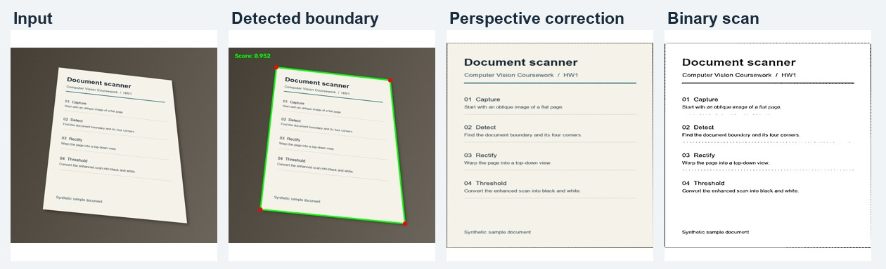
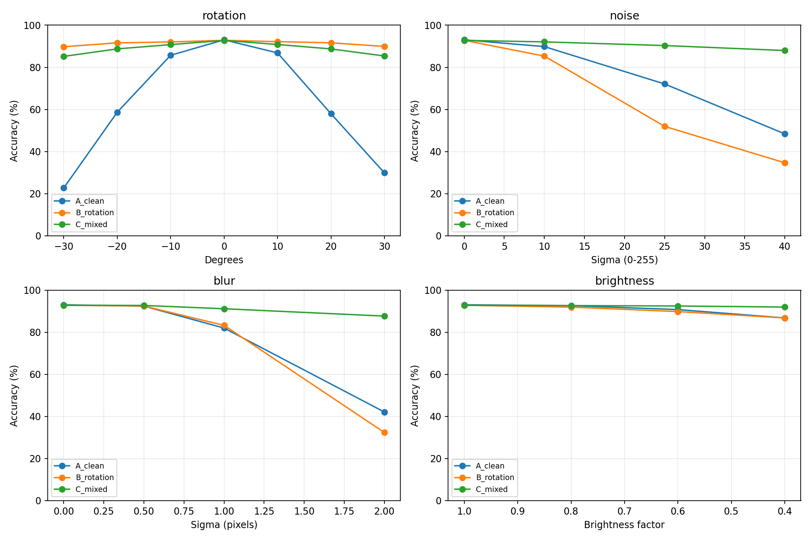

# Computer Vision Coursework

Four assignments covering document scanning, feature-based object localization, and image classification on Fashion-MNIST.

| Assignment | Method | Result |
| --- | --- | --- |
| [HW1 · Document Scanner](hw1/) | Canny edges, document boundary detection, and perspective correction | Produces a top-down, binarized scan from an oblique photo |
| [HW2 · SIFT-Based Object Localization](hw2/) | SIFT, Lowe's ratio test, and RANSAC | Correctly detected presence or absence on all 7 coursework images |
| [HW3 · Fashion-MNIST: MLP vs. CNN](hw3/) | PyTorch classifiers evaluated on the same test set | 88.95% MLP and 93.35% CNN test accuracy |
| [HW4 · Data Augmentation for Robust Classification](hw4/) | Clean, rotation-only, and mixed-augmentation CNN training | 69.25% → 89.91% mean accuracy across 15 corruptions with mixed augmentation |

## Document scanning



## Robustness under image corruptions



The three HW4 runs used seed 42. Each model was selected using validation loss and evaluated on the same clean and corrupted test images.

## Setup

Create and activate a Python virtual environment, then install the dependencies from the repository root.

```sh
python -m pip install -r requirements.txt
```

HW1 and HW2 use OpenCV and NumPy. HW3 and HW4 also use PyTorch, Matplotlib, and tqdm. Each assignment links to its inputs and run commands above.
