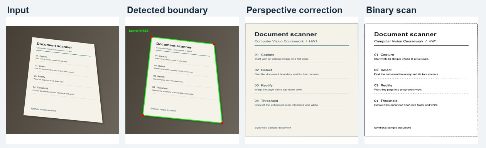

# HW1 · Document Scanner

This OpenCV pipeline adjusts brightness and removes noise before detecting the page boundary. It warps the four corners into a top-down view, enhances contrast, and thresholds the result.



The example uses a synthetic document. It is included so the scanner can be run immediately.

## Run

Install the [project dependencies](../requirements.txt). From the repository root:

```sh
cd hw1
python hw1.py
```

The script scans the images in `data/` and saves intermediate stages and the final image in `output/<image-name>/`. Add your own JPG, PNG, or BMP files to try other documents.
