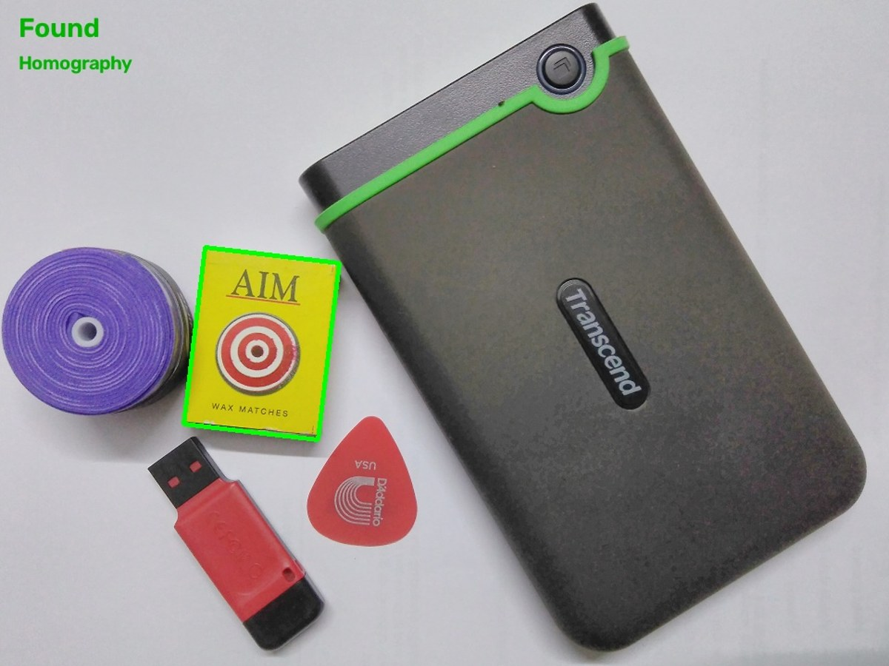
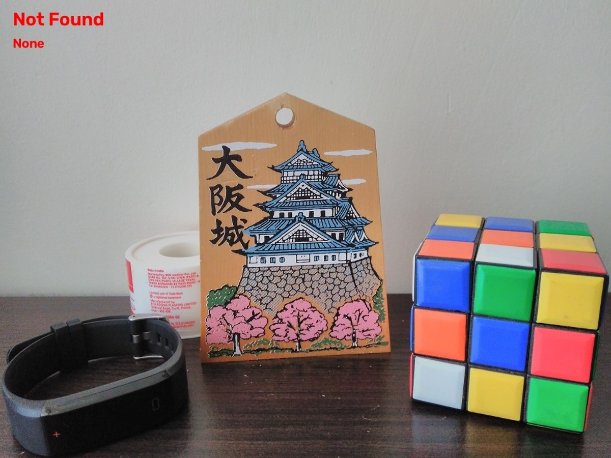

# HW2 · SIFT-Based Object Localization

The pipeline extracts SIFT descriptors, filters nearest-neighbor matches with Lowe's ratio test, and estimates a homography with RANSAC. An affine estimate provides a fallback when enough consistent matches remain.

On the original seven-image coursework set, the baseline (Lowe ratio 0.75 and RANSAC threshold 5 px) correctly classified five positive and two negative images. The full parameter sweep is available in the [results JSON](results/parameter-sweep.json).

| Object found | Object absent |
| --- | --- |
|  |  |

## Run

Install the [project dependencies](../requirements.txt). Add a reference image at `hw2/hw2/source.png` and test images named `test*.png` or `test*.jpg` in the same directory. For meaningful accuracy with your own inputs, update `POSITIVE_IMAGES` in [hw2.py](hw2.py) to match their filename stems.

```sh
python hw2/hw2.py
```

Annotated matches and the parameter sweep are saved to `hw2/output/task3/`.
