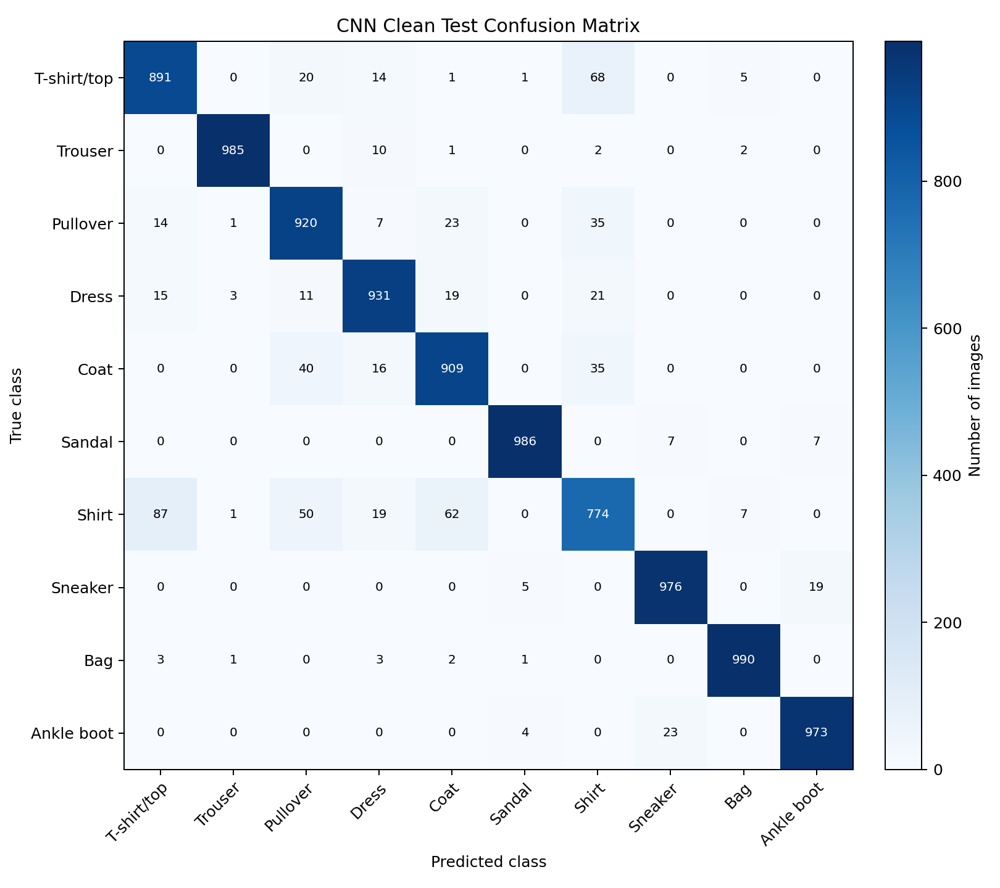

# HW3 · Fashion-MNIST: MLP vs. CNN

The MLP and CNN share a stratified train/validation split and the official Fashion-MNIST test set. The recorded test results use the checkpoint with the lowest validation loss for each model.

| Model | Parameters | Test accuracy | Macro F1 |
| --- | ---: | ---: | ---: |
| MLP | 243,658 | 88.95% | 0.8883 |
| CNN | 172,650 | 93.35% | 0.9332 |



[MLP test metrics](results/mlp-test-results.csv) · [CNN test metrics](results/cnn-test-results.csv)

## Run

Install the [project dependencies](../requirements.txt). Download the four IDX files from the [official Fashion-MNIST repository](https://github.com/zalandoresearch/fashion-mnist#get-the-data) and place them in `hw3/data/`. The scripts accept both the original `.gz` files and their decompressed versions.

From the repository root:

```sh
python hw3/task2_prepare.py
python hw3/train_mlp.py --dropout 0.2 --device auto
python hw3/train_cnn.py --conv-dropout 0.2 --device auto
```

Each trainer prints its timestamped output folder. Substitute those folders for `MLP_RUN` and `CNN_RUN` to evaluate rotation, noise, blur, and brightness changes:

```sh
python hw3/task4.py --device auto --mlp-checkpoint "MLP_RUN/mlp_best.pt" --cnn-checkpoint "CNN_RUN/cnn_best.pt"
```

The supplemental [task5.py](task5.py) trains an augmented CNN:

```sh
python hw3/task5.py train --device auto --baseline "CNN_RUN/cnn_best.pt"
python hw3/task5.py evaluate --device auto --run-dir "AUGMENTED_RUN"
```

Use the folder printed by the augmentation training command for `AUGMENTED_RUN`.
