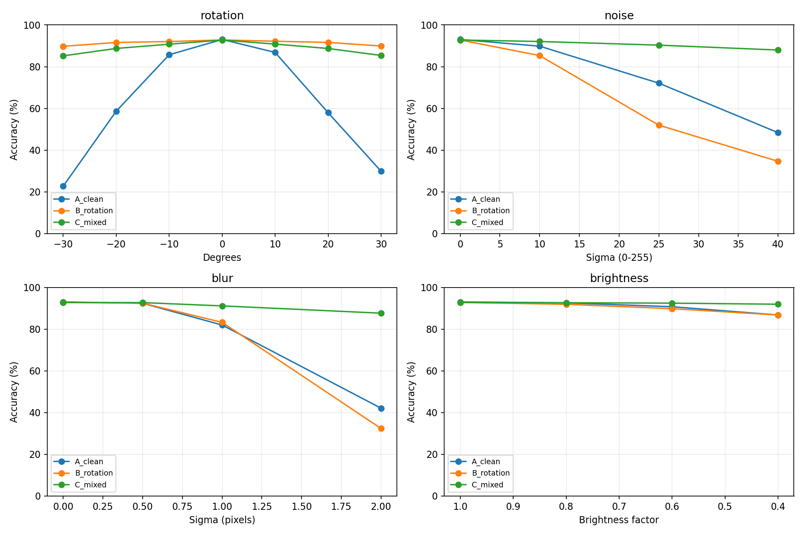

# HW4 · Data Augmentation for Robust Classification

Three CNNs are trained from scratch with the same architecture and data split. They differ in training augmentation: clean images only, rotation only, or a mixture of rotation, Gaussian noise, blur, and brightness changes.

| Training | Clean test | Mean over 15 corruptions | Mean over rotation conditions |
| --- | ---: | ---: | ---: |
| Clean only | 93.05% | 69.25% | 56.96% |
| Rotation only | 92.81% | 79.71% | **91.20%** |
| Mixed augmentation | 92.79% | **89.91%** | 88.28% |

Mixed augmentation improved mean corrupted accuracy by 20.67 percentage points over clean-only training. Rotation-only augmentation had the best result on rotation. These are single-seed results (seed 42). See the [test results CSV](results/test-aggregate.csv).



## Run

Complete the [HW3 dataset preparation and CNN training](../hw3/#run) first. HW4 uses the HW3 split and baseline checkpoint to verify the experiment settings. Substitute the timestamped HW3 CNN output folder for `CNN_RUN`. From the repository root in PowerShell:

```powershell
$runArgs = @(
    '--data-dir', 'hw3/data',
    '--split-file', 'hw3/outputs/task2/split_indices.npz',
    '--baseline', 'CNN_RUN/cnn_best.pt',
    '--device', 'auto'
)
python hw4/HW4_experiments/hw4_experiments.py check @runArgs
python hw4/HW4_experiments/hw4_experiments.py train @runArgs
python hw4/HW4_experiments/hw4_experiments.py evaluate @runArgs
```

Training uses the validation set to select checkpoints. Evaluation uses the official test set after training, and writes results to `hw4/HW4_experiments/outputs/hw4_abc/`.
